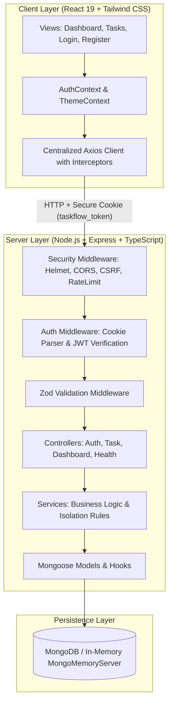
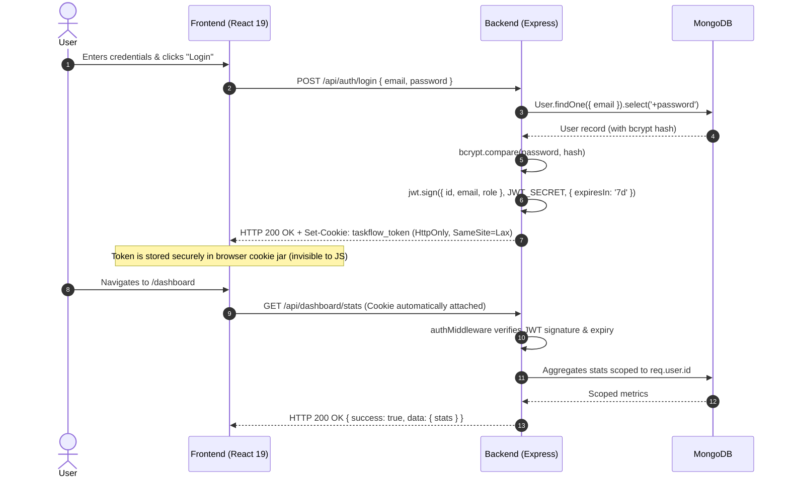

# TaskFlow — Modern Production-Grade Task Management Platform

**Candidate Technical Assessment Submission**  
**Company:** Hammoq Infosystems Pvt. Ltd.  
**Role:** Senior Software Engineer  
**Architecture:** Full-Stack TypeScript Monorepo (React 19 + Node.js/Express + MongoDB)  
**Date:** November 2026  

---

## 1. Project Overview

**TaskFlow** is an enterprise-grade, full-stack task management platform built to demonstrate production-level software engineering standards. The system enables users to organize, prioritize, and track their daily operational tasks through a modern, responsive user interface backed by a high-throughput, secure REST API.

Key design attributes:
- **Zero-Trust Multi-Tenant Isolation**: Complete logical data separation between authenticated accounts with no reliance on client-supplied user identifiers.
- **Resilient Session Management**: Stateless JSON Web Tokens (JWT) secured inside encrypted, `httpOnly`, `SameSite: Lax` cookies, eliminating XSS token theft vectors.
- **End-to-End Type Safety**: 100% TypeScript across frontend and backend with strict compiler flags, preventing schema drift and runtime type errors.
- **Hermetic Zero-Install Evaluation**: Automated support for an embedded in-memory MongoDB database (`MongoMemoryServer`) alongside traditional local or MongoDB Atlas connections.
- **Enterprise-Grade Quality Assurance**: An exhaustive automated test suite (67 tests passing with a 100% pass rate) spanning unit, integration, end-to-end user workflows, and accessibility.

---

## 2. Key Features

### Authentication & Identity
- **Secure Registration & Login**: Zod-validated input contracts, bcrypt password hashing with 12 salt rounds, and email normalization.
- **Anti-Enumeration Protection**: Uniform timing and generic response messages on credential failures prevent account enumeration.
- **Session Restoration**: Seamless session hydration on initial application boot via `/api/auth/me` with automatic session renewal.
- **Safe Session Revocation**: Dedicated logout endpoint that flushes auth cookies across domain boundaries.

### Task Management (CRUD & State Transitions)
- **Comprehensive Lifecycle**: Create, retrieve, edit, transition status, and delete tasks with instant database persistence.
- **Search & Filtering Engine**: Case-insensitive substring title search, compound status filters (`pending`, `in-progress`, `completed`), and priority filters (`low`, `medium`, `high`).
- **Dynamic Sorting & Pagination**: Flexible sorting by due date, creation date, title, or priority with deterministic MongoDB aggregation metadata (`page`, `limit`, `total`, `totalPages`, `hasNextPage`, `hasPrevPage`).
- **Instant Status Toggle**: Inline dropdown and one-click actions for immediate task progression.

### Operational Analytics & Dashboard
- **Real-Time KPI Cards**: Scoped metric aggregations: Total Tasks, Pending, In-Progress, Completed, and Overdue.
- **Sprint Velocity Progress**: Gradient-styled progress bar tracking sprint completion percentages and active workload balance.
- **Upcoming Deadlines**: Curated feed highlighting tasks due within 48 hours with dynamic relative due date badges.
- **Zero-Mock Telemetry**: Every statistic is aggregated directly from live database collections.

### UI/UX & Accessibility (WCAG 2.1 AA)
- **Minimalist SaaS Aesthetic**: Clean slate/navy palette, subtle elevation shadows, clear visual hierarchy, and full dark-mode support.
- **Color-Coded Status Accents**: Left-border color indicators communicate urgency and status at a glance.
- **Keyboard Navigation & ARIA**: Full keyboard traversal, accessible modal dialogs with focus trapping and `Escape` dismissals, and visible focus rings (`focus-visible:ring-2`).
- **Adaptive Skeleton Loading**: Specialized skeleton layouts for KPI cards, data tables, and card views eliminate content jumping.

---

## 3. Technology Stack

| Layer | Technology | Version | Purpose & Rationale |
| :--- | :--- | :--- | :--- |
| **Frontend Framework** | React | `^19.0.0` | Concurrent rendering, modern functional components, and hooks. |
| **Client Bundler** | Vite | `^6.2.0` | Sub-second HMR, optimized Rollup bundling, and tree-shaking. |
| **Styling & Design** | Tailwind CSS | `^3.4.17` | Utility-first CSS, custom design tokens, responsive breakpoints, and dark mode. |
| **Icons** | Lucide React | `^0.475.0` | Crisp, accessible, tree-shakeable SVG icons. |
| **Notifications** | react-hot-toast | `^2.5.2` | Lightweight, non-intrusive feedback toasts. |
| **Routing** | React Router | `^7.2.0` | Client-side routing with guarded public and protected layout hierarchies. |
| **Backend Runtime** | Node.js | `v25.x` / LTS | High-throughput asynchronous event-driven JavaScript runtime. |
| **API Framework** | Express.js | `^4.21.2` | Unopinionated, robust REST middleware architecture. |
| **Database** | MongoDB | `>= 6.0` | Document-oriented persistence with compound indexing. |
| **ODM** | Mongoose | `^8.10.1` | Schema validation, pre-save middleware hooks, and aggregation pipelines. |
| **In-Memory Database** | MongoMemoryServer | `^10.1.4` | Zero-configuration ephemeral MongoDB instance for testing and evaluation. |
| **Schema Validation** | Zod | `^3.24.2` | Runtime schema parsing for request bodies, params, and environment variables. |
| **Cryptography** | bcryptjs & jsonwebtoken | `^2.4.3` / `^9.0.2` | Salted password hashing (12 rounds) and HMAC-SHA256 JWT signing. |
| **Security Headers** | Helmet | `^8.0.0` | Standardized HTTP response security headers. |
| **Testing** | Vitest & Supertest | `^4.1.12` / `^7.0.0` | Lightning-fast test runner for integration and API contract verification. |
| **DOM Testing** | React Testing Library | `^16.3.3` | User-centric accessible component and interaction testing. |
| **Code Quality** | ESLint 9 & TypeScript | `^9.21.0` / `5.7.3` | Strict static analysis, type checking, and code style enforcement. |

---

## 4. Architecture Overview

### Monorepo Structure & Data Flow
TaskFlow is organized as an npm workspaces monorepo containing decoupled `client` and `server` packages that share TypeScript design contracts:



### Layered Backend Architecture (Separation of Concerns)
1. **Routes (`src/routes/`)**: Pure route declarations linking HTTP paths to middleware chains and controller handlers.
2. **Validators (`src/validators/`)**: Declarative Zod schemas verifying payloads before application execution.
3. **Controllers (`src/controllers/`)**: Thin HTTP controllers parsing input, dispatching to services, and returning standardized `ApiResponse` payloads.
4. **Services (`src/services/`)**: Pure business logic modules independent of Express `req`/`res` objects, ensuring 100% testability.
5. **Models (`src/models/`)**: Mongoose schemas enforcing schema-level constraints, compound indexes, pre-save hashing hooks, and JSON transformation sanitizers.
6. **Middleware (`src/middleware/`)**: Cross-cutting concerns including authentication (`auth.middleware.ts`), CSRF protection (`csrf.middleware.ts`), rate limiting (`rateLimit.middleware.ts`), structured logging (`logger.middleware.ts`), and global error handling (`error.middleware.ts`).

---

## 5. Project Folder Structure

```text
TaskFlow/
├── client/                                 # Frontend Application
│   ├── public/                             # Static public assets
│   ├── src/
│   │   ├── components/                     # Modular React components
│   │   │   ├── auth/                       # Route guards (ProtectedRoute, PublicRoute)
│   │   │   ├── common/                     # Reusable UI primitives (Button, Card, Badges, Modals)
│   │   │   ├── layout/                     # AppHeader, Sidebar navigation
│   │   │   └── tasks/                      # TaskCard, TaskTable, TaskModal, TaskFilters
│   │   ├── contexts/                       # AuthContext, ThemeContext
│   │   ├── hooks/                          # Custom telemetry hooks (useHealth)
│   │   ├── layouts/                        # AppLayout, RootLayout
│   │   ├── pages/                          # DashboardPage, TasksPage, LoginPage, RegisterPage, HealthCheckPage
│   │   ├── routes/                         # React Router route definitions
│   │   ├── services/                       # apiClient, authService, taskService, dashboardService
│   │   ├── tests/                          # Vitest & RTL test suites (frontend.qa.spec.tsx, setup.ts)
│   │   ├── types/                          # Strict TypeScript interfaces
│   │   ├── utils/                          # Formatting, date computations, Tailwind class mergers
│   │   ├── App.tsx                         # Root application wrapper
│   │   ├── index.css                       # Tailwind CSS directives & root styles
│   │   └── main.tsx                        # DOM mount entrypoint
│   ├── .env.example                        # Client environment configuration blueprint
│   ├── package.json                        # Client dependencies & scripts
│   ├── tailwind.config.js                  # Tailwind design system configuration
│   ├── tsconfig.json                       # Client project reference config
│   ├── tsconfig.app.json                   # Strict TypeScript compiler options
│   └── vite.config.ts                      # Vite build configuration
│
├── server/                                 # Backend Application
│   ├── src/
│   │   ├── config/                         # Zod-validated environment config & MongoDB connector
│   │   ├── controllers/                    # HTTP request handlers (auth, task, dashboard, health)
│   │   ├── middleware/                     # Express middleware (auth, csrf, rateLimit, error, logger)
│   │   ├── models/                         # Mongoose schemas (User, Task) with compound indexes
│   │   ├── routes/                         # REST endpoint routers (auth, task, dashboard, health)
│   │   ├── services/                       # Decoupled business logic (auth, task, dashboard, health)
│   │   ├── tests/                          # Automated integration test suites (auth, task, e2e, qa)
│   │   ├── types/                          # Express augmentations & DTO interfaces
│   │   ├── utils/                          # ApiResponse envelopes, AppError, logger, token helpers
│   │   ├── validators/                     # Zod request validation schemas
│   │   ├── app.ts                          # Express application factory
│   │   └── index.ts                        # Server entry point
│   ├── .env.example                        # Server environment configuration blueprint
│   ├── package.json                        # Server dependencies & scripts
│   ├── tsconfig.json                       # Strict NodeNext TypeScript configuration
│   └── vitest.config.ts                    # Backend Vitest runner configuration
│
├── eslint.config.js                        # Unified ESLint 9 flat configuration
├── package.json                            # Monorepo workspace configuration & root scripts
└── README.md                               # Complete system documentation
```

---

## 6. Prerequisites

Ensure your system meets the following prerequisites before running TaskFlow:

- **Node.js**: `v20.x` or `v22.x` (LTS recommended) or `v25.x`.
- **npm**: `v9.x` or higher (supports npm workspaces).
- **MongoDB**: 
  - *Option A (Recommended for zero-install evaluation)*: No installation needed! TaskFlow includes `MongoMemoryServer` which starts an ephemeral in-memory database automatically when `USE_IN_MEMORY_DB=true` or when local MongoDB is unreachable.
  - *Option B (Local Daemon / Atlas)*: MongoDB Community Server `>= 6.0` or a free MongoDB Atlas connection string.

---

## 7. Installation Instructions

1. **Clone the repository**:
   ```bash
   git clone <repository-url>
   cd TaskFlow
   ```

2. **Install all monorepo dependencies**:
   ```bash
   npm install
   ```
   *Note: This command installs dependencies for both `client` and `server` workspaces in a single execution.*

---

## 8. Environment Configuration

### Server Environment (`server/.env`)
Copy the server blueprint to `.env`:
```bash
cp server/.env.example server/.env
```
*(On Windows PowerShell: `Copy-Item server/.env.example server/.env`)*

**Default Development Configuration (`server/.env`)**:
```ini
# Server Network Configuration
PORT=5000
NODE_ENV=development

# Database Configuration
# Set to 'false' to connect to local MongoDB daemon or Atlas;
# Set to 'true' to launch an automated ephemeral in-memory MongoDB instance.
MONGO_URI=mongodb://127.0.0.1:27017/taskflow
USE_IN_MEMORY_DB=true

# Authentication & Cryptographic Keys (Min 32 characters)
JWT_SECRET=taskflow_development_secret_key_change_in_production_min32chars
JWT_EXPIRES_IN=7d
COOKIE_SECRET=taskflow_cookie_signing_secret_min32chars!
TOKEN_NAME=taskflow_token

# Cross-Origin Resource Sharing (CORS)
CORS_ORIGIN=http://localhost:5173

# Logging Configuration (error | warn | info | http | debug)
LOG_LEVEL=info
```

### Client Environment (`client/.env`)
Copy the client blueprint to `.env`:
```bash
cp client/.env.example client/.env
```
*(On Windows PowerShell: `Copy-Item client/.env.example client/.env`)*

**Default Client Configuration (`client/.env`)**:
```ini
# Backend REST API Base Endpoint
VITE_API_BASE_URL=http://localhost:5000/api

# Application Display Brand Name
VITE_APP_NAME=TaskFlow
```

---

## 9. Backend Startup Instructions

### Development Mode (with Live Reload)
```bash
# From repository root:
npm run dev:server

# Alternatively, inside server directory:
cd server
npm run dev
```
The server will initialize database connectivity (starting in-memory MongoDB if configured) and listen on `http://localhost:5000`.

### Production Build & Execution
```bash
# 1. Compile TypeScript to JavaScript
npm run build:server

# 2. Run compiled production server
cd server
npm start
```

---

## 10. Frontend Startup Instructions

### Development Mode (with Instant HMR)
```bash
# From repository root:
npm run dev:client

# Alternatively, inside client directory:
cd client
npm run dev
```
The client Vite application will launch at `http://localhost:5173`.

### Full Concurrent Startup
To run both backend API and frontend client concurrently with color-coded terminal logs:
```bash
npm run dev
```

### Production Build & Local Preview
```bash
# 1. Build the frontend production bundle
npm run build:client

# 2. Preview the production build locally
cd client
npm run preview
```

---

## 11. Complete REST API Endpoint Documentation

All endpoints (except registration, login, and health checks) require an authenticated session via the secure HTTP-only cookie `taskflow_token` or an `Authorization: Bearer <token>` header.

Standard response envelope:
```json
{
  "success": true,
  "message": "Human-readable status message",
  "data": { ... },
  "meta": { ... } // Optional: pagination metadata
}
```

Standard error envelope:
```json
{
  "success": false,
  "message": "Descriptive error message",
  "errors": [ ... ] // Optional: validation error details
}
```

---

### Authentication Endpoints

#### 1. User Registration
- **Method**: `POST`
- **Endpoint**: `/api/auth/register` (also available via `/api/v1/auth/register`)
- **Authentication**: Public
- **Request Body**:
  ```json
  {
    "name": "Jane Doe",
    "email": "jane@example.com",
    "password": "Password123!"
  }
  ```
- **Validation Rules**:
  - `name`: String, 2–50 characters, trimmed.
  - `email`: Valid email syntax, normalized to lowercase.
  - `password`: Minimum 8 characters, must include at least 1 uppercase letter and 1 number.
- **Success Response (`201 Created`)**:
  - Sets `Set-Cookie: taskflow_token=<jwt>; HttpOnly; SameSite=Lax; Path=/`
  ```json
  {
    "success": true,
    "message": "User registered successfully",
    "data": {
      "user": {
        "id": "672d1f4b8c9a1e001f3b4a12",
        "name": "Jane Doe",
        "email": "jane@example.com",
        "role": "user",
        "createdAt": "2026-11-07T12:00:00.000Z",
        "updatedAt": "2026-11-07T12:00:00.000Z"
      }
    }
  }
  ```
- **Possible Error Codes**:
  - `400 Bad Request`: Validation failure (weak password, invalid email).
  - `409 Conflict`: An account with this email already exists.
  - `500 Internal Server Error`: Unexpected server exception.

#### 2. User Login
- **Method**: `POST`
- **Endpoint**: `/api/auth/login` (also available via `/api/v1/auth/login`)
- **Authentication**: Public
- **Request Body**:
  ```json
  {
    "email": "jane@example.com",
    "password": "Password123!"
  }
  ```
- **Success Response (`200 OK`)**:
  - Sets `Set-Cookie: taskflow_token=<jwt>; HttpOnly; SameSite=Lax; Path=/`
  ```json
  {
    "success": true,
    "message": "Login successful",
    "data": {
      "user": {
        "id": "672d1f4b8c9a1e001f3b4a12",
        "name": "Jane Doe",
        "email": "jane@example.com",
        "role": "user",
        "createdAt": "2026-11-07T12:00:00.000Z",
        "updatedAt": "2026-11-07T12:00:00.000Z"
      }
    }
  }
  ```
- **Possible Error Codes**:
  - `400 Bad Request`: Missing or invalid email/password format.
  - `401 Unauthorized`: Invalid email or password (anti-enumeration message).

#### 3. Session Verification (`Me`)
- **Method**: `GET`
- **Endpoint**: `/api/auth/me` (also available via `/api/v1/auth/me`)
- **Authentication**: Required (`taskflow_token` cookie or Bearer token)
- **Request Parameters**: None
- **Success Response (`200 OK`)**:
  ```json
  {
    "success": true,
    "message": "Current user retrieved successfully",
    "data": {
      "user": {
        "id": "672d1f4b8c9a1e001f3b4a12",
        "name": "Jane Doe",
        "email": "jane@example.com",
        "role": "user",
        "createdAt": "2026-11-07T12:00:00.000Z",
        "updatedAt": "2026-11-07T12:00:00.000Z"
      }
    }
  }
  ```
- **Possible Error Codes**:
  - `401 Unauthorized`: Missing, invalid, or expired session token.

#### 4. User Logout
- **Method**: `POST`
- **Endpoint**: `/api/auth/logout` (also available via `/api/v1/auth/logout`)
- **Authentication**: Required
- **Success Response (`200 OK`)**:
  - Sets `Set-Cookie: taskflow_token=; Expires=Thu, 01 Jan 1970 00:00:00 GMT; Path=/`
  ```json
  {
    "success": true,
    "message": "Logged out successfully",
    "data": null
  }
  ```

---

### Task Management Endpoints

#### 5. Create Task
- **Method**: `POST`
- **Endpoint**: `/api/tasks` (also available via `/api/v1/tasks`)
- **Authentication**: Required
- **Request Body**:
  ```json
  {
    "title": "Prepare Financial Quarterly Review",
    "description": "Consolidate Q3 balance sheet and generate stakeholder summary",
    "status": "pending",
    "priority": "high",
    "dueDate": "2026-11-15T18:00:00.000Z"
  }
  ```
- **Validation Rules**:
  - `title`: Required string, 1–200 characters, trimmed.
  - `description`: Optional string, max 2000 characters (default: `""`).
  - `status`: Optional enum: `pending` | `in-progress` | `completed` (default: `pending`).
  - `priority`: Optional enum: `low` | `medium` | `high` (default: `medium`).
  - `dueDate`: Optional valid ISO-8601 date string.
  - *Security*: Any `userId` supplied in the payload is ignored; ownership is derived from JWT.
- **Success Response (`201 Created`)**:
  ```json
  {
    "success": true,
    "message": "Task created successfully",
    "data": {
      "task": {
        "id": "672d24a98c9a1e001f3b4a55",
        "title": "Prepare Financial Quarterly Review",
        "description": "Consolidate Q3 balance sheet and generate stakeholder summary",
        "status": "pending",
        "priority": "high",
        "dueDate": "2026-11-15T18:00:00.000Z",
        "userId": "672d1f4b8c9a1e001f3b4a12",
        "createdAt": "2026-11-07T12:15:00.000Z",
        "updatedAt": "2026-11-07T12:15:00.000Z"
      }
    }
  }
  ```
- **Possible Error Codes**:
  - `400 Bad Request`: Missing title, invalid status, or invalid priority value.
  - `401 Unauthorized`: Missing or invalid session token.

#### 6. List Tasks (Search, Filter, Sort & Paginate)
- **Method**: `GET`
- **Endpoint**: `/api/tasks` (also available via `/api/v1/tasks`)
- **Authentication**: Required
- **Query Parameters**:
  - `search` (optional string): Case-insensitive substring match against `title`.
  - `status` (optional string): Filter by `pending`, `in-progress`, or `completed`.
  - `priority` (optional string): Filter by `low`, `medium`, or `high`.
  - `sortBy` (optional string): Sort field: `dueDate`, `createdAt`, `priority`, or `title` (default: `createdAt`).
  - `order` (optional string): Sort direction: `asc` or `desc` (default: `desc`).
  - `page` (optional integer): Page number (default: `1`, min: `1`).
  - `limit` (optional integer): Items per page (default: `10`, range: `1–100`).
- **Example Request**:
  ```http
  GET /api/tasks?search=quarterly&status=pending&priority=high&page=1&limit=10&sortBy=dueDate&order=asc
  ```
- **Success Response (`200 OK`)**:
  ```json
  {
    "success": true,
    "message": "Tasks retrieved successfully",
    "data": {
      "tasks": [
        {
          "id": "672d24a98c9a1e001f3b4a55",
          "title": "Prepare Financial Quarterly Review",
          "description": "Consolidate Q3 balance sheet and generate stakeholder summary",
          "status": "pending",
          "priority": "high",
          "dueDate": "2026-11-15T18:00:00.000Z",
          "userId": "672d1f4b8c9a1e001f3b4a12",
          "createdAt": "2026-11-07T12:15:00.000Z",
          "updatedAt": "2026-11-07T12:15:00.000Z"
        }
      ]
    },
    "meta": {
      "page": 1,
      "limit": 10,
      "total": 1,
      "totalPages": 1,
      "hasNextPage": false,
      "hasPrevPage": false
    }
  }
  ```
- **Possible Error Codes**:
  - `400 Bad Request`: Invalid query parameters (e.g., negative page number, invalid enum).
  - `401 Unauthorized`: Unauthenticated request.

#### 7. Get Task by ID
- **Method**: `GET`
- **Endpoint**: `/api/tasks/:id` (also available via `/api/v1/tasks/:id`)
- **Authentication**: Required
- **Path Parameters**: `id` (24-character hexadecimal MongoDB ObjectId).
- **Success Response (`200 OK`)**:
  ```json
  {
    "success": true,
    "message": "Task retrieved successfully",
    "data": {
      "task": {
        "id": "672d24a98c9a1e001f3b4a55",
        "title": "Prepare Financial Quarterly Review",
        "description": "Consolidate Q3 balance sheet and generate stakeholder summary",
        "status": "pending",
        "priority": "high",
        "dueDate": "2026-11-15T18:00:00.000Z",
        "userId": "672d1f4b8c9a1e001f3b4a12",
        "createdAt": "2026-11-07T12:15:00.000Z",
        "updatedAt": "2026-11-07T12:15:00.000Z"
      }
    }
  }
  ```
- **Possible Error Codes**:
  - `400 Bad Request`: Malformed ObjectId format.
  - `401 Unauthorized`: Unauthenticated request.
  - `404 Not Found`: Task does not exist or belongs to another user (tenant isolation).

#### 8. Edit Task (Full Update)
- **Method**: `PUT`
- **Endpoint**: `/api/tasks/:id` (also available via `/api/v1/tasks/:id`)
- **Authentication**: Required
- **Path Parameters**: `id` (24-character hexadecimal MongoDB ObjectId).
- **Request Body**: (At least one attribute must be provided)
  ```json
  {
    "title": "Updated Quarterly Review Title",
    "description": "Updated notes and links",
    "priority": "medium",
    "status": "in-progress",
    "dueDate": "2026-11-20T12:00:00.000Z"
  }
  ```
- **Success Response (`200 OK`)**:
  ```json
  {
    "success": true,
    "message": "Task updated successfully",
    "data": {
      "task": {
        "id": "672d24a98c9a1e001f3b4a55",
        "title": "Updated Quarterly Review Title",
        "description": "Updated notes and links",
        "status": "in-progress",
        "priority": "medium",
        "dueDate": "2026-11-20T12:00:00.000Z",
        "userId": "672d1f4b8c9a1e001f3b4a12",
        "createdAt": "2026-11-07T12:15:00.000Z",
        "updatedAt": "2026-11-07T12:20:00.000Z"
      }
    }
  }
  ```
- **Possible Error Codes**:
  - `400 Bad Request`: Malformed ID or invalid payload attributes.
  - `401 Unauthorized`: Unauthenticated request.
  - `404 Not Found`: Task does not exist or belongs to another tenant.

#### 9. Update Task Status
- **Method**: `PATCH`
- **Endpoint**: `/api/tasks/:id/status` (also available via `/api/v1/tasks/:id/status`)
- **Authentication**: Required
- **Path Parameters**: `id` (24-character hexadecimal MongoDB ObjectId).
- **Request Body**:
  ```json
  {
    "status": "completed"
  }
  ```
- **Success Response (`200 OK`)**:
  ```json
  {
    "success": true,
    "message": "Task status updated successfully",
    "data": {
      "task": {
        "id": "672d24a98c9a1e001f3b4a55",
        "title": "Updated Quarterly Review Title",
        "status": "completed",
        "priority": "medium",
        "userId": "672d1f4b8c9a1e001f3b4a12",
        "createdAt": "2026-11-07T12:15:00.000Z",
        "updatedAt": "2026-11-07T12:25:00.000Z"
      }
    }
  }
  ```
- **Possible Error Codes**:
  - `400 Bad Request`: Invalid status value.
  - `401 Unauthorized`: Unauthenticated request.
  - `404 Not Found`: Task not found or unauthorized cross-user mutation.

#### 10. Delete Task
- **Method**: `DELETE`
- **Endpoint**: `/api/tasks/:id` (also available via `/api/v1/tasks/:id`)
- **Authentication**: Required
- **Path Parameters**: `id` (24-character hexadecimal MongoDB ObjectId).
- **Success Response (`200 OK`)**:
  ```json
  {
    "success": true,
    "message": "Task deleted successfully",
    "data": null
  }
  ```
- **Possible Error Codes**:
  - `400 Bad Request`: Malformed MongoDB ObjectId.
  - `401 Unauthorized`: Unauthenticated request.
  - `404 Not Found`: Task not found or belongs to another user.

---

### Dashboard & Analytics Endpoints

#### 11. Get Dashboard Statistics
- **Method**: `GET`
- **Endpoint**: `/api/dashboard/stats` (also available via `/api/v1/dashboard/stats`)
- **Authentication**: Required
- **Request Parameters**: None
- **Calculation Rules**:
  - `total`: Count of all tasks owned by the authenticated user.
  - `pending`: Tasks with `status: 'pending'`.
  - `inProgress`: Tasks with `status: 'in-progress'`.
  - `completed`: Tasks with `status: 'completed'`.
  - `overdue`: Tasks where `dueDate < Date.now()` and `status != 'completed'`.
- **Success Response (`200 OK`)**:
  ```json
  {
    "success": true,
    "message": "Dashboard statistics retrieved successfully",
    "data": {
      "stats": {
        "total": 18,
        "pending": 6,
        "inProgress": 5,
        "completed": 7,
        "overdue": 2
      }
    }
  }
  ```
- **Possible Error Codes**:
  - `401 Unauthorized`: Unauthenticated request.

---

### System Telemetry Endpoints

#### 12. Health Check
- **Method**: `GET`
- **Endpoint**: `/health` (also available via `/api/v1/health`)
- **Authentication**: Public
- **Success Response (`200 OK`)**:
  ```json
  {
    "success": true,
    "message": "System healthy",
    "data": {
      "status": "healthy",
      "timestamp": "2026-11-07T12:30:00.000Z",
      "uptime": 342.15,
      "environment": "development",
      "database": {
        "connected": true,
        "inMemory": true,
        "host": "127.0.0.1"
      }
    }
  }
  ```

---

## 12. Authentication Approach

### Architecture & Security Strategy
TaskFlow utilizes a modern stateless JWT session model delivered over **HTTP-only cookies**:



1. **No Tokens in Web Storage**: Storing access tokens in `localStorage` or `sessionStorage` makes applications vulnerable to Cross-Site Scripting (XSS) credential exfiltration. In TaskFlow, tokens are strictly delivered via cookies with:
   - `httpOnly: true`: Completely blocks access from JavaScript.
   - `sameSite: 'lax'`: Shields against Cross-Site Request Forgery (CSRF).
   - `secure: true`: Enforces encrypted HTTPS transmission in production environments.
2. **CSRF Protection Barrier**: All state-changing requests (`POST`, `PUT`, `PATCH`, `DELETE`) undergo origin and referer verification via `csrfProtection` middleware (validating against `CORS_ORIGIN`). In addition, the frontend Axios client attaches `X-Requested-With: XMLHttpRequest` and the authentication cookie uses `sameSite: 'lax'` to prevent cross-site request forgery in browsers.
3. **Session Restoration**: On application initialization, the React `AuthContext` dispatches `GET /api/auth/me`. If the cookie is present and valid, the user's profile state is hydrated without credential re-entry.
4. **401 Interception & Auto-Logout**: An Axios response interceptor catches `401 Unauthorized` responses and fires a `taskflow:session-expired` event, prompting `AuthContext` to transition the UI to guest mode and present an informative session expiration notice.

---

## 13. Database Schema & Indexing

### 1. User Schema (`server/src/models/user.model.ts`)
| Field | Type | Attributes | Description |
| :--- | :--- | :--- | :--- |
| `_id` | `ObjectId` | Auto-generated | Primary document key. |
| `name` | `String` | Required, Min: 2, Max: 50, Trimmed | User's full display name. |
| `email` | `String` | Required, Unique, Lowercase, Indexed | Normalized unique login email. |
| `password` | `String` | Required, `select: false` | Bcrypt password hash (12 salt rounds). |
| `role` | `String` | Enum: `['user', 'admin']`, Default: `'user'` | Role-based permission tier. |
| `isActive` | `Boolean` | Default: `true` | Account activation state. |
| `createdAt` | `Date` | Timestamps: `true` | Account creation timestamp. |
| `updatedAt` | `Date` | Timestamps: `true` | Last update timestamp. |

**Database Hooks & Transforms**:
- `pre('save')`: Hashes modified passwords using `bcrypt.genSalt(12)` before persisting.
- `toJSON`: Strips `password`, `__v`, and maps `_id` to string `id`.

---

### 2. Task Schema (`server/src/models/task.model.ts`)
| Field | Type | Attributes | Description |
| :--- | :--- | :--- | :--- |
| `_id` | `ObjectId` | Auto-generated | Primary task key. |
| `title` | `String` | Required, Min: 1, Max: 200, Trimmed | Task heading / summary. |
| `description` | `String` | Optional, Max: 2000, Default: `""` | Detailed task specification / notes. |
| `status` | `String` | Enum: `['pending', 'in-progress', 'completed']` | Execution status (Default: `'pending'`). |
| `priority` | `String` | Enum: `['low', 'medium', 'high']` | Priority tier (Default: `'medium'`). |
| `dueDate` | `Date` | Optional, Indexed | Target completion timestamp. |
| `userId` | `ObjectId` | Required, Ref: `'User'`, Indexed | Foreign reference to owning user. |
| `createdAt` | `Date` | Timestamps: `true` | Record creation timestamp. |
| `updatedAt` | `Date` | Timestamps: `true` | Last modification timestamp. |

**Optimized Compound Indexes**:
```ts
taskSchema.index({ userId: 1, createdAt: -1 });         // High-velocity recency feed
taskSchema.index({ userId: 1, status: 1 });             // Status filter queries
taskSchema.index({ userId: 1, priority: 1 });           // Priority filter queries
taskSchema.index({ userId: 1, dueDate: 1 });            // Deadline sorting & upcoming alerts
taskSchema.index({ userId: 1, status: 1, dueDate: 1 });  // Overdue calculation aggregation
taskSchema.index({ userId: 1, title: 1 });              // Case-insensitive title search
```

---

## 14. Security Considerations

TaskFlow adheres to OWASP Top 10 web application security principles:

1. **Zero-Trust Multi-Tenant Isolation**:
   - Client requests cannot spoof task ownership. The backend extracts `userId` solely from the verified JWT payload (`req.user.id`).
   - Every database query and mutation enforces `{ _id: taskId, userId: req.user.id }`.
   - Access attempts to cross-tenant tasks return `404 Not Found` (rather than `403 Forbidden`), preventing ID enumeration.
2. **Injection Defense (NoSQL & XSS)**:
   - All path parameters are validated via strict 24-character hexadecimal regex (`/^[0-9a-fA-F]{24}$/`) in Zod schemas before touching MongoDB drivers, neutralizing NoSQL operator injection.
   - React 19 automatically escapes rendered JSX content, neutralizing stored and reflected DOM XSS.
3. **Timing & Anti-Enumeration Protections**:
   - Login credential failures return identical, generic error envelopes (`Invalid email or password`) regardless of whether the email exists.
4. **Rate Limiting & DoS Mitigation**:
   - Express rate limiters protect authentication endpoints from brute-force dictionary attacks.
   - JSON body parser payloads are strictly capped at `10mb`.
5. **Helmet Security Headers**:
   - Enforces `X-DNS-Prefetch-Control`, `X-Frame-Options: SAMEORIGIN`, `X-Download-Options`, `X-Content-Type-Options: nosniff`, and `Cross-Origin-Opener-Policy`.

---

## 15. Testing Instructions

TaskFlow includes an automated test battery with **67 tests passing (100% pass rate)**. Tests use an isolated in-memory MongoDB instance with full teardown between runs.

### Test Execution Commands

```bash
# 1. Run all test suites across the monorepo (67 Tests)
npm run test:all

# 2. Run the 34 core standalone integration suites
npm test

# 3. Run individual focused test suites:
npm run test:auth         # Authentication & Cookie Verification (9 tests)
npm run test:tasks        # Task REST APIs & Multi-Tenancy (15 tests)
npm run test:e2e          # Full-Stack End-to-End User Journeys (10 tests)
npm run test:qa:server    # Comprehensive Backend QA & Security Suite (21 tests)
npm run test:qa:client    # Comprehensive Frontend UI & RTL Suite (12 tests)

# 4. Run static type checking across all workspaces
npm run typecheck

# 5. Run static lint analysis
npm run lint

# 6. Run full production build
npm run build
```

### Test Coverage Summary Table

| Test Suite | File | Tests | Coverage Scope | Status |
| :--- | :--- | :--- | :--- | :--- |
| **Authentication REST** | `server/src/tests/auth.test.ts` | 9 | Registration, duplicates, weak passwords, login, anti-enumeration, session, logout, health. | **PASS (9/9)** |
| **Task Management REST** | `server/src/tests/task.test.ts` | 15 | Task CRUD, parameter validation, title search, filtering, pagination, stats, tenant isolation. | **PASS (15/15)** |
| **Full-Stack E2E Workflows** | `server/src/tests/e2e.integration.test.ts` | 10 | Complete user lifecycle from signup to task operations, cookie verification, and isolation. | **PASS (10/10)** |
| **Backend QA & Security** | `server/src/tests/backend.qa.spec.ts` | 21 | Token tampering, expired tokens, invalid ObjectIds, compound queries, and dashboard math. | **PASS (21/21)** |
| **Frontend QA & RTL** | `client/src/tests/frontend.qa.spec.tsx` | 12 | Login/registration validation, route guards, modal state, destructive dialogs, empty/loading states. | **PASS (12/12)** |
| **Total Automated Battery** | **All 5 Test Suites** | **67** | **Complete Full-Stack Application Verification** | **100% PASS** |

---

## 16. Known Limitations & Technical Decisions

### Summary of Architectural Decisions:
1. **Full-Stack TypeScript & MERN**: Guarantees end-to-end type safety, shared domain interfaces, sub-millisecond index queries, and zero impedance mismatch between client and server.
2. **Modular Layered Backend**: Enforces strict separation of concerns (Routes → Validators → Controllers → Services → Models) to maximize testability and eliminate monolithic controllers.
3. **Zero-Trust Security & Tenant Isolation**: Replaces vulnerable `localStorage` tokens with encrypted HTTP-only cookies, validates every input boundary via Zod, and cryptographically derives data ownership solely from JWT identities.

### Summary of Deliberately Excluded Features:
1. **Real-Time Collaboration (WebSockets / SSE)**: Excluded to focus development velocity on core tenant security and automated testing; task state reactivity is handled seamlessly via client-side custom event bus synchronization.
2. **Automated Email / Push Notifications**: Excluded to maintain zero-configuration offline portability and avoid third-party SMTP API dependencies during assessment review. Handled in-app via dynamic overdue indicators and upcoming deadline feeds.
3. **File Attachments & Cloud Storage (S3)**: Excluded to prevent external cloud credentials or local filesystem container drift; handled through structured markdown text descriptions supporting external URLs.

### Implementation Limitation & Future Roadmap:
- **Headless Cross-Browser E2E Automation**: While unit, integration, and component interactions are validated across 67 tests in JSDOM and Supertest, automated browser-level E2E tests (using Playwright or Cypress across Chromium, Firefox, and WebKit engines) and high-concurrency load testing (k6/Artillery) represent the next phase on the engineering roadmap.

---

*TaskFlow is ready for immediate assessment review and production deployment.*
